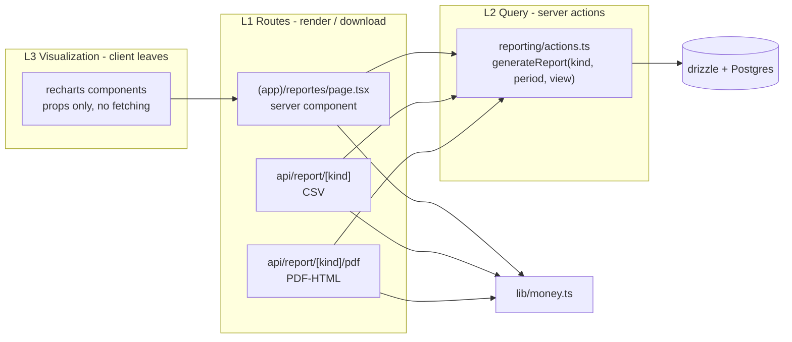

# Architecture Spine — Reporting & Data Export

## Design Paradigm

**Server-first layered** inside the existing single Next.js App Router app. Data flows down, presentation flows up; nothing in a lower layer reaches around the query layer.



## Invariants & Rules

### AD-1 — Reporting module location

- **Binds:** all reporting UI, export routes, dashboard
- **Prevents:** ad-hoc report queries scattered across pages and duplicated aggregation logic
- **Rule:** every report metric is computed by a server action in `src/app/reporting/actions.ts` and consumed by the page at `src/app/(app)/reportes/page.tsx` (inheriting the `(app)` layout + MobileNav, Spanish-slug route convention); components never query `db` directly. Module code (`actions.ts`, `types.ts`, `config.ts`) lives under `src/app/reporting/`; a "Reportes" entry is added to `src/components/mobile-nav.tsx`.

### AD-2 — Export is server-side Route Handler only

- **Binds:** CSV and PDF export endpoints
- **Prevents:** client-side export leaking db credentials or building blobs in the browser
- **Rule:** export endpoints are Route Handlers under `src/app/api/report/` that return an HTTP `Response` with `Content-Disposition: attachment`; CSV is built by streaming rows, PDF by rendering HTML server-side.

### AD-3 — Report data contract

- **Binds:** every report output (charts, tables, CSV, PDF)
- **Prevents:** inconsistent column sets / date formats / currency formatting across exports
- **Rule:** the report shape is defined once in `src/app/reporting/types.ts`; CSV and PDF consumers both consume the same `Report` object, never re-derive columns from raw rows.

### AD-4 — Money formatting is centralized

- **Binds:** all currency display and export
- **Prevents:** MXN vs USD mixups and locale drift between UI and CSV/PDF
- **Rule:** a single `src/lib/money.ts` helper formats every numeric amount as MXN with 2 decimals; exports use the same helper so PDF and CSV match the screen.

### AD-5 — Inventory threshold is one shared constant

- **Binds:** inventory report, stock alert, dashboard
- **Prevents:** dashboard and inventory report disagreeing on what "low stock" means
- **Rule:** the low-stock threshold lives in `src/app/reporting/config.ts` (default 5) and is applied by the same predicate `getDashboardStats` uses; no page hardcodes a stock threshold.

### AD-6 — Messages-to-send is a derived view, not an entity

- **Binds:** messaging report
- **Prevents:** inventing a message store that duplicates order/customer channel data
- **Rule:** the "messages to send" report is a view over `orders`/`customers` grouped by channel with a status filter (`pending`/`processing`); no new messaging table is created for reporting.

### AD-7 — Report data model

- **Binds:** all report consumers (charts, tables, CSV, PDF)
- **Prevents:** per-report ad-hoc row shapes
- **Rule:** a report is `{kind, view, title, generatedAt, period, rows, summary}` in `src/app/reporting/types.ts`; `rows` is an array of plain string-keyed objects, `summary` a record of scalars; numeric fields inside `rows`/`summary` are JS numbers, converted once inside `generateReport` (pg `numeric` arrives as strings) — no per-consumer conversion; exporters consume this object as-is.

### AD-8 — The report set is closed

- **Binds:** reporting page, export endpoints
- **Prevents:** an unbounded list of bespoke report types
- **Rule:** four kinds only — `sales` (by day / channel / product), `inventory` (on hand, low-stock, sold-out), `messages` (by channel, pending orders), `expenses` (by category, totals). Each kind's row breakdowns are its `view` values, declared as an enum in `src/app/reporting/types.ts`. A new kind = enum value + query in `reporting/actions.ts` + a row in the report set table; no report exists outside this set.

### AD-9 — Single generation entry point

- **Binds:** every report consumer including the page and both exporters
- **Prevents:** each chart/table re-implementing its own SQL
- **Rule:** `generateReport(kind, period, view)` in `src/app/reporting/actions.ts` returns a typed `Report`; `view` selects the row breakdown and must be one of the kind's enum values in `types.ts` (unknown kind/view → 404 at the route, never a thrown error). The page calls it once per kind+view and the CSV/PDF exporters call the same function — they differ only in serialization. Shared aggregates (sales totals, low-stock count) derive from the same helpers in `src/app/reporting/` that `getDashboardStats` uses — no second total formula anywhere.

### AD-10 — CSV export

- **Binds:** all CSV output
- **Prevents:** inconsistent quoting/escaping per report
- **Rule:** `src/app/api/report/[kind]/route.ts` returns `text/csv; charset=utf-8` with a header row, `Content-Disposition: attachment; filename="<kind>-<from>_<to>.csv"`, values quoted only when they contain comma/quote/newline, numbers as raw digits (never locale-formatted).

### AD-11 — PDF export

- **Binds:** all PDF output
- **Prevents:** adding a headless-browser dependency for a fidelity requirement that does not exist yet
- **Rule:** `src/app/api/report/[kind]/pdf/route.ts` renders the `Report` to standalone HTML server-side and returns it with `Content-Disposition: attachment`; the user prints to PDF from the browser. Same `Report` + money helper as CSV, so numbers match. No puppeteer/playwright in `package.json`.

### AD-12 — Charts are server-fed client leaves

- **Binds:** all chart/table rendering on the reporting page and dashboard
- **Prevents:** duplicate client queries, hydration drift, two charting approaches
- **Rule:** chart components are `"use client"` recharts components receiving `Report.rows` as props from the server page; tables render server-side as plain HTML. No `fetch` to report endpoints from client components. recharts (pinned in `package.json`) is the only charting library.

### AD-13 — Period is one typed range everywhere

- **Binds:** report generation, page UI, both export URLs
- **Prevents:** each consumer inventing its own date-window parameter shape
- **Rule:** `period` is `{from, to}` as `YYYY-MM-DD` (half-open `[from, to)`), passed as `?from=&to=` query params to the page and exporters (alongside `?view=`), defaulted to the current month in `America/Mexico_City`; exported in `Report.period`.

## Consistency Conventions

| Concern | Convention |
| --- | --- |
| Naming (entities, files, interfaces, events) | Routes Spanish kebab-case under `(app)` (`/reportes`); module files English (`actions.ts`, `types.ts`, `config.ts`); report kinds lowercase enum strings; export files `<kind>-<from>_<to>.<ext>` |
| Data & formats (ids, dates, error shapes) | Period = `YYYY-MM-DD` half-open range; `generatedAt` ISO-8601; money MXN 2 decimals via `lib/money.ts` in UI/PDF, raw digits in CSV; CSV UTF-8 `text/csv` |
| State & cross-cutting (mutation, errors, logging, config) | Pages `export const dynamic = "force-dynamic"` (matches every existing page); config constants centralized in `reporting/config.ts`; unknown `kind`/`view` on export URLs → 404, never a 500/stack trace; the app has no auth today — export endpoints inherit that posture (see Deferred) |

## Stack

SEED — verified current at authoring; the code owns it once the code exists.

| Name | Version |
| --- | --- |
| Next.js (App Router, Route Handlers) | 16.2.6 |
| React (Server/Client Components) | 19.2.6 |
| Drizzle ORM / pg | 0.45.2 / 8.20.0 |
| recharts (sole charting library) | 3.10.1 |
| TypeScript | 5.9.3 |
| Tailwind CSS | 4.1.17 |
| CSV / PDF libraries | none (stdlib string building / server-rendered HTML) |

## Structural Seed

```text
src/
  app/
    (app)/
      reportes/page.tsx        # server page: generateReport per kind -> tables + chart props + export buttons
    reporting/
      actions.ts               # generateReport(kind, period, view) - the only report SQL
      types.ts                 # Report, ReportKind, Period
      config.ts                # LOW_STOCK_THRESHOLD, report set table, period defaults
    api/report/
      [kind]/route.ts          # CSV download (AD-10)
      [kind]/pdf/route.ts      # print-to-PDF HTML download (AD-11)
  lib/money.ts                 # single MXN formatter (AD-4)
  components/                  # recharts client leaves, props-only (AD-12)
```

Report set (closed, AD-8):

| kind | Rows | Primary sources |
| --- | --- | --- |
| `sales` | by day / by channel / by product | `orders`, `order_items` |
| `inventory` | on hand / low-stock / sold-out | `products` (+ threshold from `config.ts`) |
| `messages` | customers & pending orders per channel | `customers.preferred_channel`, `orders.channel` |
| `expenses` | by category + totals | `expenses` |

## Deferred

- **Authentication on export endpoints** — the whole app is open today; when auth arrives it wraps the route handlers, not this module. Revisit when any auth lands.
- **True binary PDF (puppeteer/playwright)** — browser print-to-PDF suffices; revisit on a fidelity / serve-PDF-directly requirement (ASSUMPTION, memlog).
- **CSV delimiter/locale configurability** — comma + UTF-8 fixed; revisit only on an Excel-LatAm import need (ASSUMPTION, memlog).
- **Scheduled / emailed reports, report history table** — no trigger exists; revisit on a recurring-report request.
- **Deployment & environments, infra** — owned by `_bmad-output/plan-tiendaflow-deployable.md`, not this feature slice.
- **Multi-tenant scoping, i18n beyond es-MX** — no product requirement yet.

