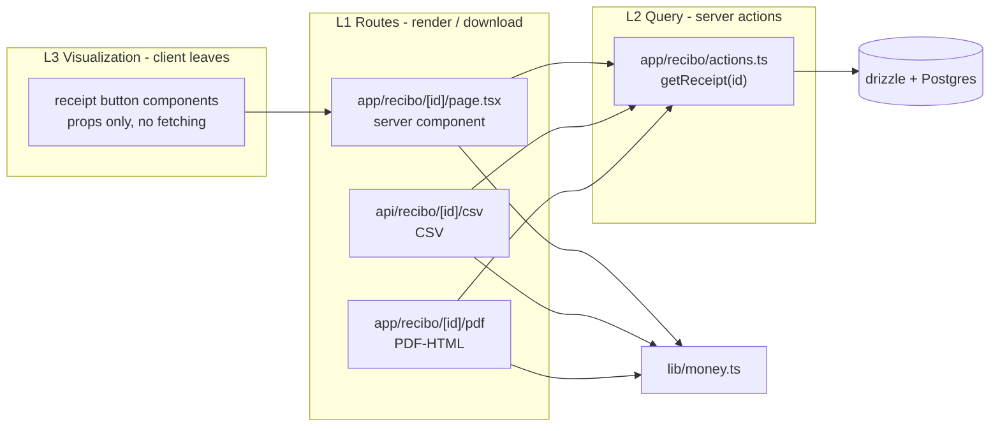

# Architecture Spine — Receipt Generation & Export

## Design Paradigm

**Server-first layered** inside the existing single Next.js App Router app. Data flows down, presentation flows up; nothing in a lower layer reaches around the query layer.



## Inherited Invariants

| Inherited | From parent | Binds here |
| --- | --- | --- |
| AD-1..AD-13 | architecture-reporting-export | server-first layered paradigm; routes Spanish kebab-case under (app); module files English; export is server-side Route Handler returning Response with Content-Disposition attachment; money centralized in lib/money.ts; HTML print-to-PDF, no puppeteer; closed report set; single generation entry point; period as typed range |

## Invariants & Rules

### AD-1 — Paradigm: server-first layered

- **Binds:** all receipt UI, export routes
- **Prevents:** client-side receipt rendering or direct db access from components
- **Rule:** receipt HTML is rendered server-side by a route handler from the typed Receipt object; client components are leaves receiving props only. [ADOPTED]

### AD-2 — Folio: reuse order.id as ORD-<id>

- **Binds:** all receipt consumers
- **Prevents:** a folio counter that can diverge from the order record
- **Rule:** the folio is `ORD-${order.id}`. No migration, no new column. [ADOPTED]

### AD-3 — Format: print-to-PDF via server-rendered standalone HTML

- **Binds:** all export
- **Prevents:** a headless-browser dependency for a fidelity requirement that does not exist yet
- **Rule:** the PDF endpoint returns standalone HTML with `Content-Disposition: attachment`; the user prints to PDF from the browser. No puppeteer/playwright. [ADOPTED]

### AD-4 — Money: single src/lib/money.ts formats MXN with 2 decimals

- **Binds:** all currency display and export
- **Prevents:** UI/export currency drift
- **Rule:** receipt HTML and any future CSV/PDF consume the same helper; no inline `toLocaleString` in receipt code. [ADOPTED]

### AD-5 — Receipt data contract: Receipt object defined once

- **Binds:** HTML exporter, CSV exporter, PDF exporter
- **Prevents:** inconsistent column sets / date formats / currency formatting across exports
- **Rule:** `src/app/recibo/types.ts` defines `Receipt` (folio, store, customer, items[], totals, payment). HTML, CSV, and PDF consumers all consume it as-is, never re-derive columns from raw rows. [ADOPTED]

### AD-6 — Single generation entry point: getReceipt(orderId)

- **Binds:** UI buttons, route handlers
- **Prevents:** each consumer re-implementing its own SQL
- **Rule:** `src/app/recibo/actions.ts` exports `getReceipt(orderId)` returning `Receipt | null`; unknown/foreign order → null, never a thrown error. [ADOPTED]

### AD-7 — Store scoping: getReceipt filters by storeId

- **Binds:** multi-tenancy
- **Prevents:** cross-store receipt leakage
- **Rule:** `getReceipt` filters orders by storeId (via `getStoreId`). A receipt link valid in one store returns 404 in another. [ADOPTED]

### AD-8 — Paid-only guard: the route is the guard

- **Binds:** authorization
- **Prevents:** unauthorized access to receipts for unpaid/cancelled orders
- **Rule:** non-paid `paymentStatus` or `cancelled` status → 404, never a 500/stack trace. UI buttons are hints, not authorization. [ADOPTED]

### AD-9 — Receipt set closed: one kind only — order receipt

- **Binds:** extensibility
- **Prevents:** unbounded bespoke receipt types
- **Rule:** a new kind = enum value + query in `actions.ts` + a row in the set table. No bespoke receipt outside this set. [ADOPTED]

### AD-10 — Standalone HTML: receipt HTML is self-contained

- **Binds:** PDF fidelity, offline rendering
- **Prevents:** broken prints when network fails or CSS doesn't load
- **Rule:** receipt HTML has inline CSS, no external requests, no JS. Renders correctly when printed and when opened offline. [ADOPTED]

### AD-11 — Client leaves: receipt button components receive order id prop

- **Binds:** UI integration points
- **Prevents:** client-side receipt rendering or fetching
- **Rule:** receipt button components are client leaves receiving an order id prop; they never fetch. No client-side receipt rendering. [ADOPTED]

### AD-12 — Link surface: /recibo/<id> is the canonical shareable receipt URL

- **Binds:** all trigger points
- **Prevents:** duplicate generation logic per trigger
- **Rule:** every trigger point (ventas list, quick-sale success, direct link) links to `/recibo/<id>`; the route does the work, UI only links. [ADOPTED]

## Consistency Conventions

| Concern | Convention |
| --- | --- |
| Naming (entities, files, interfaces, events) | Routes Spanish kebab-case under `(app)` (`/recibo`); module files English (`actions.ts`, `types.ts`); export files `recibo-<id>.<ext>` |
| Data & formats (ids, dates, error shapes) | Folio = `ORD-<orderId>`; `generatedAt` ISO-8601; money MXN 2 decimals via `lib/money.ts` in UI/PDF, raw digits in CSV; CSV UTF-8 `text/csv` |
| State & cross-cutting (mutation, errors, logging, config) | Pages `export const dynamic = "force-dynamic"` (matches every existing page); unknown `id` on export URLs → 404, never a 500/stack trace; auth inherited from app posture (currently none) |

## Stack

SEED — verified current at authoring; the code owns it once the code exists.

| Name | Version |
| --- | --- |
| Next.js (App Router, Route Handlers) | 16.2.6 |
| React (Server/Client Components) | 19.2.6 |
| Drizzle ORM / pg | 0.45.2 / 8.20.0 |
| TypeScript | 5.9.3 |
| Tailwind CSS | 4.1.17 |
| CSV / PDF libraries | none (stdlib string building / server-rendered HTML) |

## Structural Seed

```text
src/
  app/
    (app)/
      recibo/
        [id]/page.tsx           # server page: getReceipt -> HTML receipt
    recibo/
      actions.ts                # getReceipt(id) - the only receipt query
      types.ts                  # Receipt, ReceiptItem, StoreRef, CustomerRef
    api/recibo/
      [id]/csv/route.ts         # CSV download
      [id]/pdf/route.ts         # print-to-PDF HTML download
  lib/
    money.ts                    # single MXN formatter (AD-4)
  components/
    receipt-button.tsx          # client leaf: orderId prop -> link to /recibo/<id>
```

Receipt set (closed, AD-9):

| kind | Description | Primary sources |
| --- | --- | --- |
| `order` | Order receipt with items, totals, payment status | `orders`, `order_items`, `customers`, `stores` |

## Deferred

- **Authentication on export endpoints** — the whole app is open today; when auth arrives it wraps the route handlers, not this module. Revisit when any auth lands.
- **True binary PDF (puppeteer/playwright)** — browser print-to-PDF suffices; revisit on a fidelity / serve-PDF-directly requirement (ASSUMPTION, memlog).
- **CSV delimiter/locale configurability** — comma + UTF-8 fixed; revisit only on an Excel-LatAm import need (ASSUMPTION, memlog).
- **Tax/IVA line** — schema has no tax rate, no business RFC, no tax category. Adding one is a schema+migration change deferred to a tax requirement (ASSUMPTION, memlog).
- **Business contact on store** — phone/email not yet modeled on stores. Receipt header uses store name; contact lines render only when fields exist (ASSUMPTION, memlog).